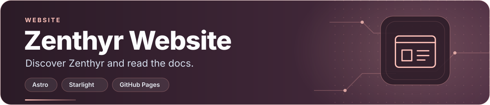

# 

The documentation and marketing site for [Zenthyr](https://github.com/svazqz/zenthyr), built with Astro and Starlight.

[](https://github.com/svazqz/zenthyr.app/actions/workflows/ci.yml)

[Quick start](#quick-start) · [Validation](#validation) · [Project layout](#project-layout)

## Quick start

Use the Node version in [`.nvmrc`](.nvmrc).

```sh
npm ci
npm run dev
```

The [published site](https://svazqz.github.io/zenthyr.app/) is available on GitHub Pages.

## Validation

```sh
npm run build
npm run preview
```

## Project layout

| Path | Purpose |
| --- | --- |
| [`src/pages/`](src/pages/) | Marketing pages |
| [`src/content/docs/`](src/content/docs/) | Documentation content |
| [`src/components/`](src/components/) | Shared site components |
| [`astro.config.mjs`](astro.config.mjs) | Astro and Starlight configuration |

## Project notes

For GitHub Pages, use the configured site URL and base path when checking asset and documentation links.
